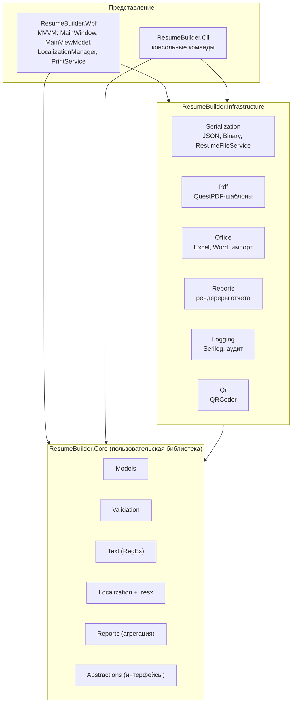
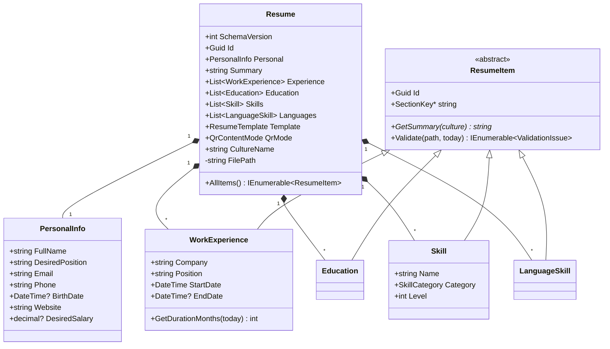
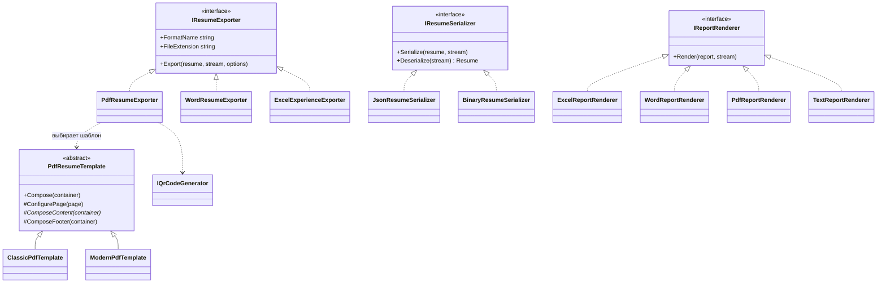
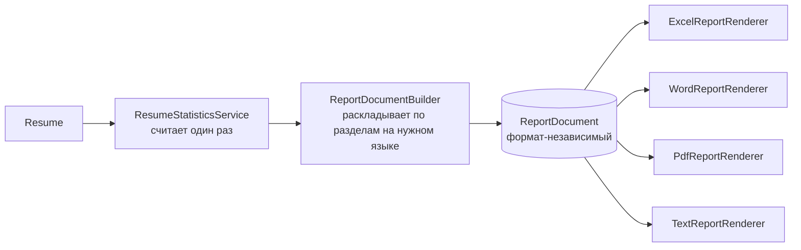
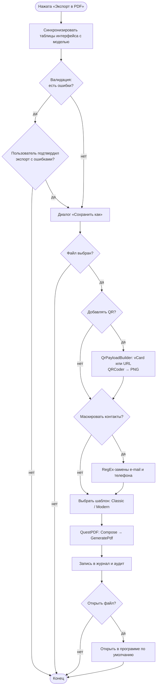
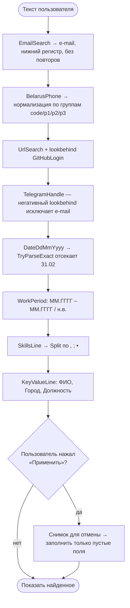

# Архитектура ResumeBuilder

Диаграммы в формате Mermaid — GitHub рисует их прямо на странице. Для записки их можно
открыть в https://mermaid.live и экспортировать в PNG/SVG.

## 1. Слои и зависимости

Зависимости направлены внутрь: ядро (`Core`) ничего не знает о форматах файлов и интерфейсе.

## 2. Диаграмма классов предметной области

## 3. Стратегии экспорта и сериализации

## 4. Сводный отчёт без дублирования подсчёта

## 5. Алгоритм экспорта в PDF (для схемы алгоритма в записке)

## 6. Алгоритм «умной вставки» (RegEx)

## 7. Паттерны проектирования

| Паттерн | Класс | Зачем |
|---|---|---|
| Строитель | `ResumeFluentBuilder` | пошаговое создание резюме (тесты, пример) |
| Хранитель (Memento) | `ResumeHistory`, `ResumeMemento` | отмена действий |
| Шаблонный метод | `PdfResumeTemplate` | общий скелет страницы, разное содержимое |
| Стратегия | `IResumeSerializer`, `IResumeExporter`, `IReportRenderer`, `IResumeValidator` | взаимозаменяемые алгоритмы |
| Компоновщик | `CompositeResumeValidator` | несколько валидаторов как один |
| Фабрика | `ResumeFileService.GetSerializer` | выбор сериализатора по расширению |
| Наблюдатель | `INotifyPropertyChanged`, `ILocalizer.CultureChanged` | обновление интерфейса |
| Команда | `RelayCommand` | действия кнопок и меню |
| Одиночка | `LocalizationManager.Instance` | единый источник строк для XAML |
| Внедрение зависимостей | `ServiceRegistration.AddResumeBuilder` | слабая связанность, тестируемость |
