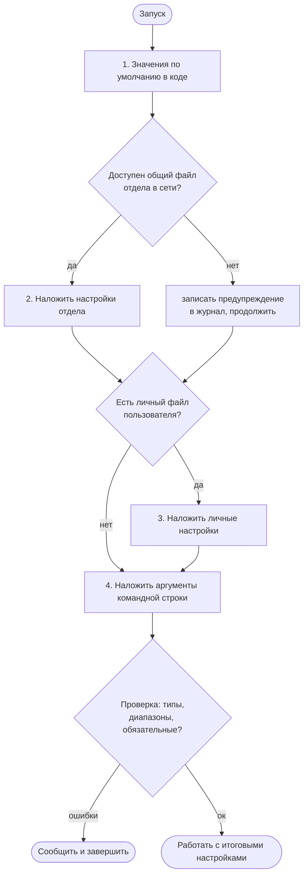
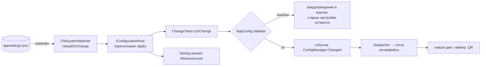
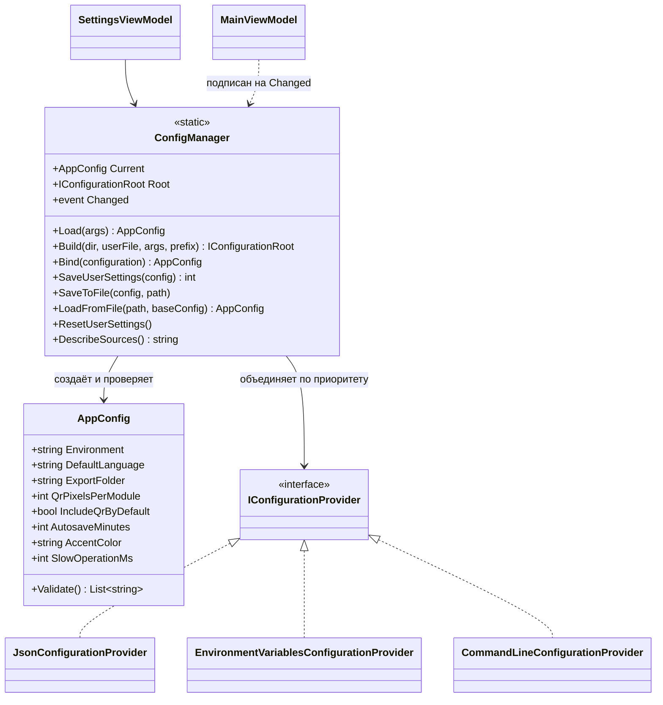

# Конфигурирование (лабораторная 9, lab32)

## Что сделано в программе

| Требование | Где |
|---|---|
| Разделение кода и настроек | секция `App` в `src/ResumeBuilder.Wpf/appsettings.json`, класс `Core/Configuration/AppConfig.cs` |
| Иерархия источников и слияние | `Core/Configuration/ConfigManager.cs` (`Build`) на `Microsoft.Extensions.Configuration` |
| Значения по умолчанию в коде | инициализаторы свойств `AppConfig` (`QrPixelsPerModule = 8` и т. д.) |
| Профили development / production | `appsettings.Development.json`, `appsettings.Production.json`; выбор: `--env Development`, переменная `RESUMEBUILDER_App__Environment` или окно «Настройки» |
| Пользовательские настройки | `%AppData%\ResumeBuilder\usersettings.json`, пишутся только отличия от дистрибутива (`SaveUserSettings`) |
| Переменные окружения | префикс `RESUMEBUILDER_`, например `RESUMEBUILDER_App__QrPixelsPerModule=12` |
| Аргументы командной строки | `--env`, `--lang`, `--export-folder` или полный ключ `--App:AutosaveMinutes=1` |
| Проверка при запуске | `AppConfig.Validate()` (DataAnnotations + проверка папки); при ошибке — сообщение и выход (`App.xaml.cs`) |
| «Горячее» обновление | `reloadOnChange: true` + `ChangeToken.OnChange` → событие `ConfigManager.Changed` → новый цвет, интервал автосохранения, размер QR применяются сразу; уровень журнала Serilog тоже меняется без перезапуска |
| Окно настроек (UI) | «Настройки…» в меню: `Views/SettingsWindow.xaml`, `ViewModels/SettingsViewModel.cs` |
| Импорт / экспорт конфигурации | кнопки «Импорт…», «Экспорт…» в окне настроек (`LoadFromFile`, `SaveToFile`) |
| Сохранение настроек окна | размер окна и последний файл — `AppSettings` (`settings.json`), сохраняются при закрытии |
| Профили запуска в Visual Studio | `Properties/launchSettings.json`: Production, Development, English (через переменные окружения) |
| Тесты | `tests/ResumeBuilder.Tests/ConfigTests.cs` — 9 тестов |

### Какие настройки есть

| Ключ | По умолчанию | Что делает |
|---|---|---|
| `App:Environment` | Production | профиль; в Development — оранжевый цвет, подробный журнал, автосохранение каждую минуту, в заголовке окна `[Development]` |
| `App:DefaultLanguage` | ru-RU | язык интерфейса (меню «Язык» пишет его в личные настройки) |
| `App:ExportFolder` | пусто = «Документы» | где открываются диалоги экспорта |
| `App:QrPixelsPerModule` | 8 | размер QR-кода в окне и в PDF |
| `App:IncludeQrByDefault` | true | галочка «Добавить QR-код» при запуске |
| `App:AutosaveMinutes` | 5 | автосохранение черновика (0 — выкл.) |
| `App:AccentColor` | #4F46E5 | основной цвет интерфейса |
| `App:SlowOperationMs` | 1000 | порог «медленной операции» для журнала |

### Как показать на защите

1. **Иерархия.** «Настройки…» → внизу список источников по приоритету.
2. **Профиль.** В Visual Studio рядом с кнопкой запуска выбрать профиль «ResumeBuilder (Development)» → F5: окно оранжевое, в заголовке `[Development]`.
3. **Переменные окружения.** Профиль «ResumeBuilder (English, env var)» → программа на английском, QR-код крупнее.
4. **Горячее обновление.** Запустить программу, открыть `bin\Debug\net8.0-windows\win-x64\appsettings.json`, поменять `"AccentColor": "#16A34A"` и сохранить — кнопки и вкладки сразу станут зелёными. Так же можно поменять `"Default": "Debug"` в `Serilog:MinimumLevel`.
5. **Проверка.** Вписать в этот файл `"QrPixelsPerModule": 100` и запустить программу — появится сообщение об ошибке в настройках.
6. **Импорт/экспорт.** «Настройки…» → «Экспорт…», поменять файл, «Импорт…».

---

## Модуль 1. Статическая конфигурация

### 1.1. Иерархия папок для «Калькулятора с историей»

```
C:\Program Files\Calculator\                   ← программа (только чтение, ставится установщиком)
├─ Calculator.exe
├─ appsettings.json                            ← настройки программы по умолчанию: уровень журнала,
└─ appsettings.Production.json                   путь к журналу, тема по умолчанию
%AppData%\Calculator\                          ← папка пользователя (запись без прав администратора)
├─ usersettings.json                           ← выбор пользователя: цвет, язык, точность
└─ history.json                                ← пользовательские ДАННЫЕ — история вычислений
%LocalAppData%\Calculator\logs\                ← журналы (могут быть большими, не синхронизируются)
```

Настройки программы лежат рядом с exe и меняются только при обновлении. Настройки и данные пользователя — в его профиле: туда можно писать без прав администратора, и при обновлении программы они не теряются. В ResumeBuilder так же: `appsettings.json` рядом с exe, `usersettings.json` и `settings.json` — в `%AppData%\ResumeBuilder`.

### 1.2. JSON, XML, YAML

Одинаковые настройки в трёх форматах — `docs/config-examples/`.

| Критерий | JSON | XML | YAML |
|---|---|---|---|
| Читаемость | хорошая | хуже: много служебных тегов | лучшая |
| Компактность | средняя | самый длинный | самый короткий |
| Простота разбора | встроен в .NET (`System.Text.Json`) | встроен (`XDocument`, `XmlSerializer`) | нужна библиотека (YamlDotNet) |
| Комментарии | **нет** (стандарт не разрешает) | есть `<!-- -->` | есть `#` |
| Ошибки | лишняя запятая ломает файл | незакрытый тег ломает файл | неверный отступ меняет смысл, найти трудно |
| Схема/проверка | JSON Schema | XSD — самая строгая | JSON Schema |

**Вывод:** выбран JSON — он встроен в .NET и `Microsoft.Extensions.Configuration`, его же использует Serilog. Комментарии к настройкам вынесены в этот документ.

## Модуль 2. Иерархия и слияние

### 2.1. Алгоритм для корпоративного клиента



Итоговое значение — из **последнего** источника, где ключ задан. Пример: по умолчанию язык `ru-RU`, отдел задал `en-US`, пользователь — ничего, в аргументах `--lang de-DE` → итог `de-DE`. Без аргумента — `en-US`.

В ResumeBuilder тот же принцип, только источников шесть (см. `ConfigManager`). Проверено тестом `ConfigTests.Priority_AppFile_UserFile_CommandLine`.

### 2.2. Переменные окружения

Почему безопаснее файла:
- значение **не попадает в репозиторий**: файл можно случайно закоммитить, переменную — нет;
- переменная задаётся на конкретной машине или в CI/CD и не копируется вместе с программой;
- в Docker/Kubernetes их можно брать из хранилища секретов, не меняя образ.

Но это не абсолютная защита: переменные видят процессы того же пользователя, они могут попасть в дамп или журнал.

**Если переменная не задана** (например, `API_KEY`):
1. Обязательная — программа при запуске сообщает «Не задана переменная API_KEY» и завершается (как ResumeBuilder при ошибке в настройках).
2. Необязательная — используется значение по умолчанию, в журнал пишется предупреждение. Так в ResumeBuilder: нет `RESUMEBUILDER_App__QrPixelsPerModule` → берётся значение из файла или 8 из кода.
3. Плохой вариант — молча работать с пустым ключом и падать позже на первом запросе с непонятной ошибкой.

## Модуль 3. Безопасность и среды

### 3.1. Секреты в открытом виде

Фрагмент с проблемой:
```json
{ "ConnectionStrings": { "Db": "Server=db;User=admin;Password=Qwerty123" }, "ApiKey": "sk-live-12345" }
```

Угрозы:
1. Файл попадает в Git — пароль видят все, у кого есть доступ к репозиторию, и он остаётся в истории даже после удаления.
2. Файл копируется вместе с программой, в архивы и резервные копии — пароль расходится по многим местам.
3. Любой пользователь компьютера или вредоносная программа может прочитать файл.
4. Один и тот же пароль на разработке и в продакшне: утечка с ноутбука разработчика = доступ к рабочей базе.

Что делать:
- переменные окружения или `dotnet user-secrets` (для разработки — хранятся вне папки проекта);
- хранилища секретов: Windows Credential Manager, Azure Key Vault, HashiCorp Vault, AWS Secrets Manager;
- шифрование части файла: в Windows — DPAPI (`ProtectedData.Protect`), ключ привязан к пользователю;
- в Git — только шаблон `appsettings.example.json` с пустыми значениями.

В ResumeBuilder секретов нет; персональные данные из резюме в журнал не пишутся (лаба 5).

### 3.2. Профили development / testing / production

| Стратегия | Как | Плюсы | Минусы |
|---|---|---|---|
| **Отдельные файлы** (используется в проекте) | `appsettings.json` + `appsettings.{Environment}.json`, профиль выбирается при запуске | просто, видно в Git, стандарт .NET | секреты так хранить нельзя |
| **Переменные CI/CD** | конвейер подставляет `RESUMEBUILDER_App__...` при сборке/развёртывании | секреты не в файлах, один артефакт для всех сред | значения разбросаны по настройкам конвейера |
| **Шаблон с подстановкой** | `appsettings.template.json` с `${DB_URL}`, при развёртывании подставляются значения | один файл-шаблон | нужен шаг подстановки |

## Модуль 4. Динамическая конфигурация

### 4.1. «Горячее» обновление



Нужны: наблюдатель за файлом, перечитывание конфигурации, событие «изменилось», проверка новых значений и переход в поток интерфейса. Вместо файла сигнал может прийти от внешней службы (опрос по таймеру или подписка).

### 4.2. Централизованное управление (1000 рабочих мест)

| | Вручную на каждой машине | Сервис конфигурации (Consul, etcd) |
|---|---|---|
| Трудоёмкость | 1000 правок, дни работы | одна правка, секунды |
| Ошибки | опечатки, забытые машины, разные версии | одно значение для всех |
| Откат | снова 1000 правок | вернуть предыдущее значение |
| Аудит | неизвестно, кто и что менял | история изменений |
| Риски | — | сервис — единая точка отказа: нужен кэш последних настроек на клиенте; изменение с ошибкой сразу попадает на все машины |

## Проект «Конфигурационный менеджер»



Паттерны: **Строитель** (`ConfigurationBuilder` — источники добавляются по шагам, `Build()` в конце), **Стратегия** (каждый провайдер — свой способ чтения), **Наблюдатель** (`ChangeToken`, событие `Changed`), **Одиночка** (`ConfigManager.Current` — один объект настроек на всю программу).
