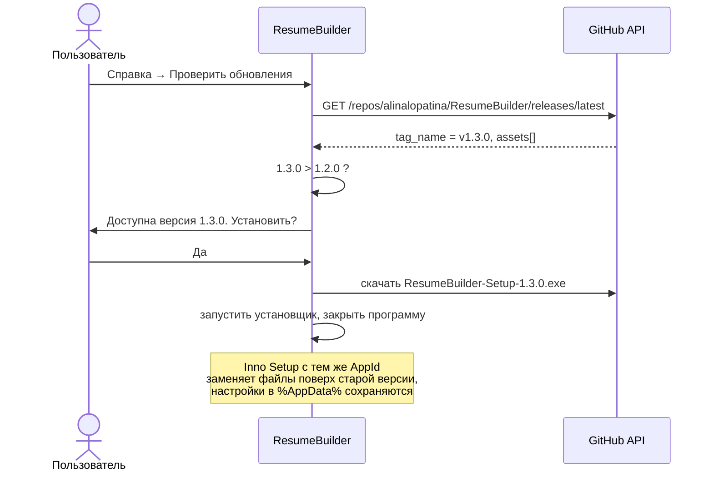

# Сборка дистрибутива (лабораторная 10.1, lab31)

## Что сделано

| Задание | Где | Как проверить |
|---|---|---|
| 1.1 Исполняемый артефакт | профиль `src/ResumeBuilder.Wpf/Properties/PublishProfiles/win-x64.pubxml`, скрипт `build/publish.ps1` | VS: ПКМ по `ResumeBuilder.Wpf` → «Опубликовать» → профиль win-x64 → «Опубликовать». Появится `publish\win-x64\ResumeBuilder.exe` |
| 1.2 Зависимости (работа на чистой системе) | self-contained + single file: среда .NET 8 и все библиотеки (QuestPDF, ClosedXML, Serilog…) внутри одного `ResumeBuilder.exe` | скопировать папку `publish\win-x64` на компьютер без .NET и запустить |
| 1.3 Файлы конфигурации при первом запуске | `ConfigManager.Load`: создаёт `%AppData%\ResumeBuilder\usersettings.json`; журналы — в `%LOCALAPPDATA%\ResumeBuilder\logs` (не рядом с exe: в Program Files писать нельзя) | удалить папку `%AppData%\ResumeBuilder` и запустить программу |
| 2.1 Установщик | Inno Setup: `installer/ResumeBuilder.iss` | `build/publish.ps1` или открыть `.iss` в Inno Setup → Compile |
| 2.2 Ярлыки и ассоциации | раздел `[Icons]` — меню «Пуск» и рабочий стол; `[Registry]` — расширение `.rbin` открывается в программе (`App.xaml.cs` берёт путь из аргументов) | установить, сохранить резюме как `.rbin`, дважды щёлкнуть по файлу |
| 2.3 Обновление | `Core/Services/UpdateService.cs` + меню «Справка → Проверить обновления…»: запрос к GitHub API `releases/latest`, сравнение версий, скачивание установщика и запуск поверх старой версии | после выпуска новой версии на GitHub |
| 3.1 Подписывание кода | `build/sign.ps1`: тестовый сертификат (`New-SelfSignedCertificate`), подпись `signtool` или `Set-AuthenticodeSignature`, проверка | `build\sign.ps1 -File dist\ResumeBuilder-Setup-1.2.0.exe`, затем «Свойства → Цифровые подписи» |
| 3.2 CI/CD | `.github/workflows/release.yml`: при теге `v*` — тесты, публикация, zip, установщик, выпуск на GitHub Releases | `git tag v1.2.1` → `git push origin v1.2.1` → вкладка Actions, затем Releases |
| 3.3 Версия из одного источника | `Directory.Build.props` → `<Version>`: из него .NET создаёт AssemblyInfo; `AppInfo.Version` читает версию в программе («Справка → О программе»), установщик берёт её из exe; одинаковый `AppId` — обновление поверх старой версии | поменять `<Version>`, пересобрать, открыть «О программе» |

## Как собрать дистрибутив у себя

1. Установить **Inno Setup 6** — https://jrsoftware.org/isdl.php (для zip-версии не нужен).
2. В терминале Visual Studio (Вид → Терминал) из корня репозитория:
   ```powershell
   powershell -ExecutionPolicy Bypass -File build\publish.ps1
   ```
3. В папке `dist` появятся:
   - `ResumeBuilder-1.2.0-portable-win-x64.zip` — портативная версия;
   - `ResumeBuilder-Setup-1.2.0.exe` — установщик.

## Портативная версия или установщик

| | Установщик (`Setup.exe`) | Портативная (`.zip`) |
|---|---|---|
| Установка | мастер, выбор папки | распаковать в любую папку |
| Ярлыки, меню «Пуск» | да | нет |
| Ассоциация `.rbin` | да | нет |
| Удаление | «Приложения и возможности» | удалить папку |
| Права администратора | не нужны (установка для пользователя) | не нужны |
| Обновление | новый установщик ставится поверх | заменить папку |
| Когда удобнее | обычный пользователь, постоянная работа | флешка, проверка на чужом компьютере, нет прав |

## Подписывание кода (3.1)

Зачем: Windows (SmartScreen) показывает «Неизвестный издатель» и может заблокировать запуск неподписанного
файла. Подпись подтверждает **автора** (кто выпустил) и **целостность** (файл не менялся после подписи).

Как работает подпись:
1. Считается хэш файла (SHA-256).
2. Хэш шифруется **закрытым** ключом разработчика — это и есть подпись.
3. Подпись и сертификат (с **открытым** ключом) добавляются в exe.
4. Windows при запуске считает хэш заново, расшифровывает подпись открытым ключом и сравнивает. Не совпало — файл изменён.

Тестовый сертификат самоподписанный: подпись есть, но Windows пишет, что корневой сертификат не доверенный.
Параметр `-Trust` добавляет его в доверенные только на своём компьютере. Настоящий сертификат покупают
у удостоверяющего центра (DigiCert, Sectigo).

## Механизм обновления (2.3)



## Выпуск новой версии (3.2 + 3.3)

1. Поменять версию в `Directory.Build.props`, например `<Version>1.2.1</Version>`, закоммитить.
2. Создать и отправить тег:
   ```bash
   git tag v1.2.1
   git push origin v1.2.1
   ```
3. GitHub Actions (`release.yml`) запустит тесты, соберёт zip и установщик и создаст выпуск на странице **Releases**.
4. В установленной версии 1.2.0 «Справка → Проверить обновления…» предложит установить 1.2.1.

## Аудит «плохо упакованного» приложения

| Проблема | Исправление в ResumeBuilder |
|---|---|
| Нужно вручную ставить .NET | self-contained: среда .NET внутри exe |
| Журналы и настройки пишутся в Program Files | `%LOCALAPPDATA%\ResumeBuilder\logs`, `%AppData%\ResumeBuilder` |
| Нет ярлыков, запуск «из папки» | ярлыки в меню «Пуск» и на рабочем столе |
| Новая версия ставится рядом со старой | постоянный `AppId`, `CloseApplications=yes` |
| «Неизвестный издатель» | подпись кода (`build/sign.ps1`) |
| Сборка вручную на компьютере разработчика | сборка и выпуск в GitHub Actions по тегу |
