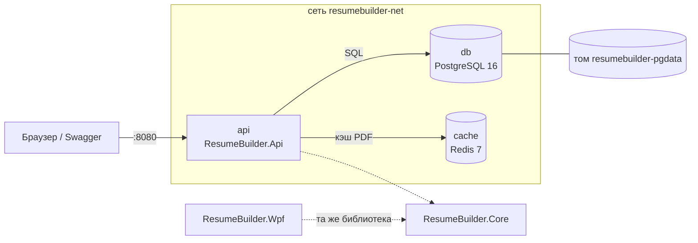
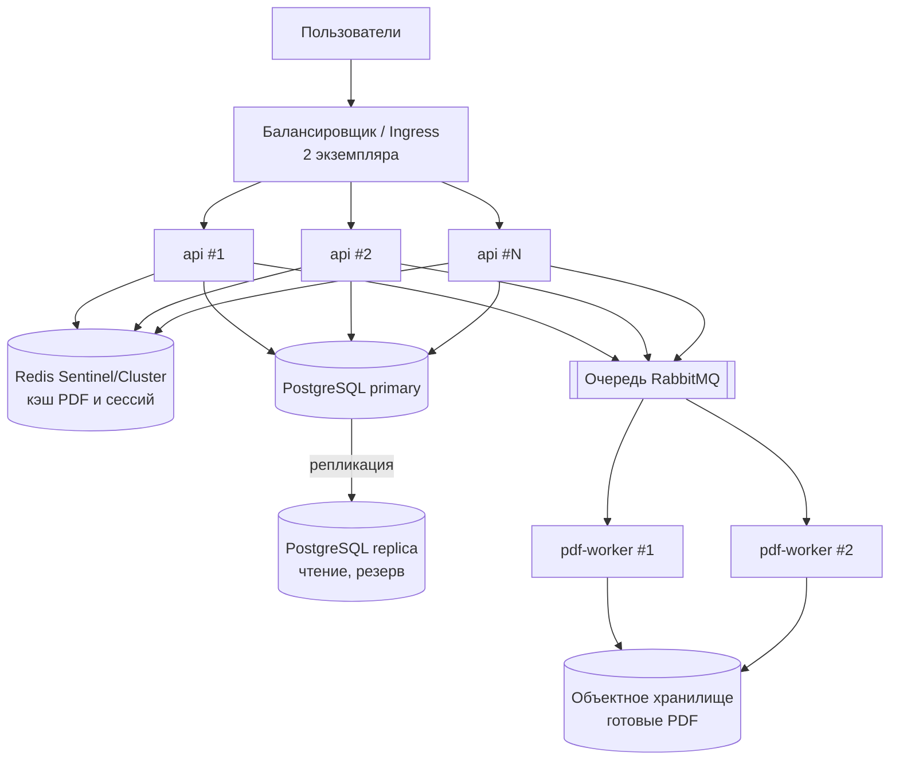

# Контейнеризация и оркестрация (лабораторные 10.2–10.3, lab33)

Программа ResumeBuilder — настольная (WPF, только Windows), а Docker запускает Linux-службы.
Поэтому для контейнера сделана **веб-служба `ResumeBuilder.Api`** на той же библиотеке `ResumeBuilder.Core`:
те же модели, проверка, PDF с QR-кодом — только вместо окон HTTP-запросы. Это хорошо показывает,
зачем логика вынесена в отдельную библиотеку: её используют и WPF-приложение, и веб-служба, и тесты.



## Методы веб-службы

| Метод | Что делает |
|---|---|
| `GET /health` | состояние: версия, хранилище (postgres/memory), кэш (redis/memory), имя контейнера |
| `GET /api/sample` | резюме-пример |
| `POST /api/validate` | проверка резюме, список ошибок (`?culture=en-US` — на английском) |
| `POST /api/pdf` | PDF с QR-кодом; повторный запрос того же резюме берётся из Redis (заголовок `X-Cache: HIT`) |
| `GET /api/qr?text=...` | картинка QR-кода |
| `POST /api/resumes`, `GET /api/resumes`, `GET /api/resumes/{id}`, `GET /api/resumes/{id}/pdf`, `DELETE /api/resumes/{id}` | сохранение резюме в PostgreSQL |

Удобнее всего проверять в браузере: **http://localhost:8080/swagger** → метод → «Try it out» → «Execute».

## Что нужно установить

**Docker Desktop** — https://www.docker.com/products/docker-desktop/ (есть для Windows, в том числе ARM, и для Mac).
После установки запустить Docker Desktop и дождаться надписи «Engine running».

## Лаба 10.2 — Docker-образ (модуль 1)

| Задание | Где |
|---|---|
| 1.1 Dockerfile | `src/ResumeBuilder.Api/Dockerfile` |
| 1.2 Зависимости, многоэтапная сборка | этап `build` (образ .NET SDK, `dotnet restore` отдельным слоем для кэша) → этап `final` (только среда ASP.NET + шрифты для PDF); пользователь не root; `HEALTHCHECK` |
| 1.3 Настройки через переменные окружения | `ASPNETCORE_HTTP_PORTS`, `ConnectionStrings__Postgres`, `ConnectionStrings__Redis`, `App__DefaultLanguage`, `App__QrPixelsPerModule` (`Program.cs`) |
| 1.4 Тег по версии и публикация в реестр | `.github/workflows/docker.yml`: при теге `v1.2.0` образ `ghcr.io/alinalopatina/resumebuilder-api:1.2.0` и `:latest` (amd64 + arm64) |

Команды (из корня репозитория):
```bash
# сборка образа с тегом версии
docker build -f src/ResumeBuilder.Api/Dockerfile -t resumebuilder-api:1.2.0 .
docker images resumebuilder-api

# запуск одного контейнера (хранение и кэш — в памяти)
docker run -d --name rb -p 8080:8080 resumebuilder-api:1.2.0
# настройки через переменные окружения: английский язык, крупный QR-код
docker run -d --name rb-en -p 8081:8080 -e App__DefaultLanguage=en-US -e App__QrPixelsPerModule=12 resumebuilder-api:1.2.0

docker ps
docker logs rb
docker stop rb rb-en && docker rm rb rb-en

# публикация в Docker Hub вручную (нужен аккаунт)
docker login
docker tag resumebuilder-api:1.2.0 <логин>/resumebuilder-api:1.2.0
docker push <логин>/resumebuilder-api:1.2.0
```

Размеры: образ SDK ~850 МБ, итоговый образ ~250 МБ — в него не попадают компилятор и исходники.

## Лаба 10.3 — Docker Compose (модуль 2)

| Задание | Где |
|---|---|
| 2.1 Несколько сервисов: приложение + БД + кэш | `docker-compose.yml`: `api`, `db` (PostgreSQL), `cache` (Redis); `depends_on` с `condition: service_healthy` — служба стартует, когда база и кэш готовы |
| 2.2 Сеть и тома | сеть `resumebuilder-net` (снаружи открыт только порт 8080), том `resumebuilder-pgdata` — данные базы сохраняются после перезапуска |
| 2.3 Управление стеком | команды ниже; автоматическая проверка — `deploy/smoke-test.sh` и `.github/workflows/docker.yml` |

```bash
docker compose up -d --build      # собрать и запустить всё одной командой
docker compose ps                 # состояние (healthy)
docker compose logs -f api        # журнал службы (Ctrl+C — выйти)
docker compose logs db cache      # журналы базы и кэша
docker compose restart api
docker compose down               # остановить и удалить контейнеры — данные в томе остаются
docker compose up -d              # снова запустить — сохранённые резюме на месте
docker compose down -v            # удалить вместе с томом
```

Секреты: пароль базы задаётся в файле `.env` (образец — `.env.example`), `.env` не попадает в Git.

## Модуль 3 — Кластер (Docker Swarm / Kubernetes)

### Docker Swarm — `deploy/swarm/stack.yml`

```bash
docker swarm init                                            # этот компьютер — manager
docker swarm join-token worker                               # команда для подключения других машин (worker)
docker build -f src/ResumeBuilder.Api/Dockerfile -t resumebuilder-api:1.2.0 .
docker stack deploy -c deploy/swarm/stack.yml resumebuilder  # 3.2 развернуть сервисы
docker service ls
docker service ps resumebuilder_api                          # 3 реплики
docker service scale resumebuilder_api=5                     # 3.3 масштабирование
docker build -f src/ResumeBuilder.Api/Dockerfile -t resumebuilder-api:1.2.1 --build-arg VERSION=1.2.1 .
docker service update --image resumebuilder-api:1.2.1 resumebuilder_api   # rolling update по одной реплике
docker service rollback resumebuilder_api                    # откат
docker stack rm resumebuilder
docker swarm leave --force
```

Роли: **manager** хранит состояние кластера и распределяет задачи, **worker** только запускает контейнеры.
Обновление настроено как `order: start-first` — новая реплика поднимается до остановки старой, простоя нет;
при ошибке — `failure_action: rollback`. Если открыть `http://localhost:8080/health` несколько раз,
меняется поле `host` — отвечают разные реплики.

### Kubernetes — `deploy/k8s/resumebuilder.yaml`

Kubernetes включается в Docker Desktop: Settings → Kubernetes → Enable Kubernetes.

```bash
kubectl apply -f deploy/k8s/resumebuilder.yaml
kubectl -n resumebuilder get pods,svc
kubectl -n resumebuilder scale deployment api --replicas=5
kubectl -n resumebuilder set image deployment/api api=resumebuilder-api:1.2.1
kubectl -n resumebuilder rollout status deployment/api
kubectl -n resumebuilder rollout undo deployment/api
kubectl delete namespace resumebuilder
```
Служба: http://localhost:30080/swagger. В манифесте: `ConfigMap` (настройки), `Secret` (пароль),
`PersistentVolumeClaim` (данные базы), `readinessProbe`/`livenessProbe` (`/health`), `RollingUpdate` с `maxUnavailable: 0`.

## Модуль 4 — Анализ и проектирование

### 4.1. Оркестрация или хореография

| | Оркестрация (центральный координатор) | Хореография (события) |
|---|---|---|
| Как | один сервис вызывает остальные по шагам | сервисы публикуют события, другие подписываются |
| Связность | координатор знает всех | сервисы не знают друг о друге |
| Отладка | процесс виден в одном месте | процесс «размазан» по событиям |
| Нужна инфраструктура | нет | брокер сообщений (RabbitMQ, Kafka) |

**Выбор для ResumeBuilder — оркестрация.** Сценарий короткий и синхронный: запрос → проверка → PDF → ответ.
`api` сам вызывает PostgreSQL и Redis. Брокер сообщений только усложнил бы систему.
Хореография имела бы смысл, если бы после сохранения резюме несколько независимых служб
(рассылка писем, аналитика, поиск вакансий) реагировали на событие «резюме сохранено».

### 4.2. Отказоустойчивая архитектура (высокая нагрузка)



- **Без состояния** (`api`, `pdf-worker`) — много реплик, масштабируются автоматически по нагрузке (HPA в Kubernetes).
- **С состоянием** (PostgreSQL, Redis, файлы) — отдельно, с репликацией и томами; готовые PDF — в объектном хранилище, а не в контейнере.
- **Тяжёлая работа** (генерация PDF) — через очередь: `api` сразу отвечает, воркеры обрабатывают задания.
- **Сеть**: наружу открыт только балансировщик; база и кэш — во внутренней сети.
- **Проверки здоровья** (`/health`) — балансировщик не отправляет запросы на «больную» реплику, оркестратор её перезапускает.
