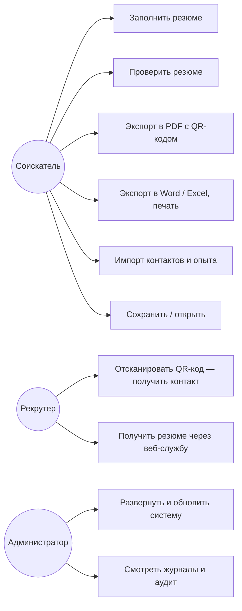
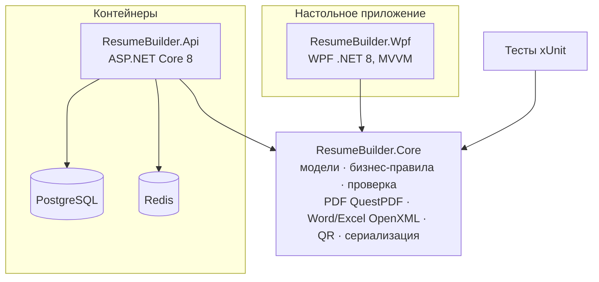
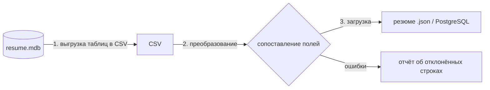

# Реинжиниринг (лабораторная 10.3, lab33 ч. 2)

Задания лабораторной — аналитические (анализ, проектирование, планирование). Как «устаревшая система»
взята типичная учебная программа предыдущего поколения — **«Резюме-мастер»** на Windows Forms / .NET Framework.
Целевая система — текущий ResumeBuilder (WPF на .NET 8 + веб-служба в контейнерах).

## 1. Инвентаризация и анализ исходной системы

### 1.1. Технологический стек «Резюме-мастера»

| Компонент | Технология | Риск |
|---|---|---|
| Язык / платформа | C# 7, .NET Framework 4.6.1 | поддержка .NET Framework 4.6.1 закончилась в 2022 г. — нет исправлений безопасности |
| Интерфейс | Windows Forms, логика в обработчиках `button1_Click` | нельзя протестировать без окна, нельзя вынести в веб |
| Данные | файл Microsoft Access `resume.mdb` через OLE DB (Jet 4.0) | Jet есть только в 32-битной Windows, нужен Access Database Engine; файл легко повредить |
| Экспорт | Microsoft Office Interop (Word) | нужен установленный Word, падает без него, не работает на сервере и в Docker |
| PDF | «Печать в PDF» через диалог Windows | нет QR-кода, нельзя автоматизировать |
| Настройки | `app.config` + запись в реестр | настройки пишутся в Program Files / HKLM — нужны права администратора |
| Журнал | `MessageBox.Show(ex.Message)` | ошибки не сохраняются, разбирать нечего |
| Тесты, документация | нет | любое изменение — риск сломать |
| Сборка | вручную в Visual Studio, архив на флешке | неизвестно, какая версия у пользователя |

### 1.2. Модель «As-Is»

```mermaid
classDiagram
    class MainForm {
        -OleDbConnection conn
        -DataSet ds
        +button1_Click()  // сохранить
        +button2_Click()  // экспорт в Word
        +button3_Click()  // печать
        +txtPhone_Leave() // проверка телефона
        +CalcExperience() int
    }
    class Module1 {
        <<static>>
        +string ConnStr
        +Log(string)
    }
    MainForm --> Module1
    MainForm ..> "Word.Application" : Interop
    MainForm ..> "resume.mdb" : SQL-строки в коде
```

Слабые места: «божественная форма» (интерфейс, SQL, расчёты и экспорт в одном классе ~3000 строк),
SQL склеивается из строк (SQL-инъекции), глобальная статическая строка подключения, нет моделей предметной области.

## 2. Извлечение бизнес-логики и требований

### 2.1. Бизнес-правила (в новой системе — в `ResumeBuilder.Core`)

| № | Правило | Псевдокод / где реализовано сейчас |
|---|---|---|
| П1 | Стаж места работы — полные месяцы; текущая работа считается до сегодня; отрицательный стаж = 0 | `months = max(0, (end ?? today) − start в месяцах)` — `WorkExperience.GetMonths` |
| П2 | Общий стаж — сумма по местам работы, показ «N г. M мес.» | `Resume.GetTotalMonths`, `FormatMonths` |
| П3 | Возраст соискателя от 14 до 100 лет, с учётом дня рождения | `PersonalInfo.GetAge`, `ResumeValidator` |
| П4 | Телефон — белорусский, приводится к `+375 (XX) XXX-XX-XX` | `TextHelper.NormalizePhone` (RegEx с группами) |
| П5 | Дата окончания учёбы/работы не раньше начала | `Education.Validate`, `WorkExperience.Validate` |
| П6 | Навыки не повторяются (без учёта регистра и пробелов), уровень 1–5 | `ResumeValidator`, `[Range(1,5)]` |
| П7 | Заполненность резюме — доля заполненных из 11 основных полей | `ReportCalculator.CalculateCompleteness` |
| П8 | Вывод по опыту: до 12 мес. — начинающий, до 36 — средний, больше — опытный | `ReportCalculator` |
| П9 | В публичной версии e-mail и телефон скрываются | `TextHelper.MaskEmails` |

### 2.2. Акторы и варианты использования



## 3. Проектирование новой архитектуры («To-Be»)

### 3.1. Выбор стратегии

| Стратегия | Суть | Для «Резюме-мастера» |
|---|---|---|
| Рефакторинг | улучшать код без смены платформы | не решает главного: .NET Framework, Jet и Interop остаются |
| **Реинжиниринг** | извлечь бизнес-правила, перестроить архитектуру на новом стеке | **выбрано**: правил немного, они ценные и понятные; интерфейс и хранение всё равно меняются |
| Замена | купить/взять готовый сервис | теряется своя логика (стаж, отчёт, QR-визитка), учебная цель не достигается |

Обоснование: скорость — средняя (переписываются слои, но правила переносятся как есть и покрываются тестами);
гибкость — максимальная (ядро без интерфейса работает в WPF, веб-службе и тестах); стоимость — ниже замены.

### 3.2. Целевая архитектура



| Было | Стало |
|---|---|
| .NET Framework 4.6.1, WinForms | .NET 8, WPF + MVVM |
| логика в форме | библиотека `ResumeBuilder.Core` |
| Access + OLE DB, SQL строками | файлы JSON / `.rbin`; на сервере PostgreSQL с параметрами запросов |
| Word Interop | Open XML SDK, ClosedXML, QuestPDF (без Office) |
| `app.config`, реестр | `appsettings.json` + профили + `%AppData%` + переменные окружения |
| MessageBox вместо журнала | Serilog: файлы, JSON, аудит |
| ручная сборка | GitHub Actions, установщик Inno Setup, Docker-образ |

## 4. Миграция данных и тестирование

### 4.1. Миграция данных



| Старое поле (Access) | Новое | Преобразование |
|---|---|---|
| `FIO` (одно поле) | `Personal.FullName` | без изменений, обрезка пробелов |
| `Tel` («80291234567», «29-123-45-67») | `Personal.Phone` | `TextHelper.NormalizePhone`; не распознан — в отчёт |
| `DataRozhd` (текст «14.03.2005») | `Personal.BirthDate` (дата) | `TextHelper.FindDate`; несуществующие даты — в отчёт |
| `Opyt` (таблица, `DateEnd = '01.01.1900'` значит «по сей день») | `Experience[].EndDate = null` | «магическая» дата → null (скрытое правило старой системы) |
| `Skills` (строка «C#, SQL; Git») | `Skills[]` | разбиение по `,` и `;`, уровень по умолчанию 3, удаление повторов |

Правила: миграция повторяемая (можно запускать много раз), исходная база не меняется,
после переноса сравниваются количество записей и контрольные суммы (общий стаж по всем резюме).

### 4.2. Стратегия тестирования

| Уровень | Что проверяем | Как в проекте |
|---|---|---|
| Модульные | каждое бизнес-правило П1–П9 отдельно, граничные значения | `ModelTests`, `ValidationTests`, `ReportTests`, `TextHelperTests` (83+ тестов) |
| Регрессионные («золотые» данные) | на одинаковых входных данных новая система считает то же, что старая: выгрузить 20–50 реальных резюме и результаты старой программы (стаж, возраст), сравнить | набор тестов `[Theory]` с ожидаемыми значениями из старой системы |
| Интеграционные | файлы туда-обратно, Word → импорт, Excel, PDF; веб-служба с PostgreSQL и Redis | `FileTests`, `deploy/smoke-test.sh` в `docker.yml` |
| Миграция | количество записей и контрольные суммы до/после; отчёт об отклонённых строках пуст или объяснён | сценарий проверки после переноса |
| Приёмочные | варианты использования UC1–UC10 вручную | чек-лист перед выпуском |

Все тесты запускаются автоматически при каждом изменении (`.github/workflows/build.yml`),
поэтому перенесённые правила не сломаются незаметно.
